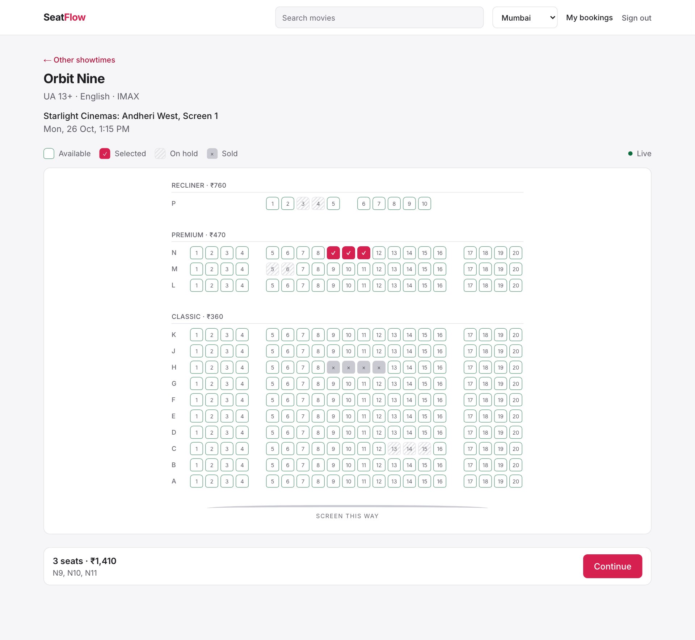
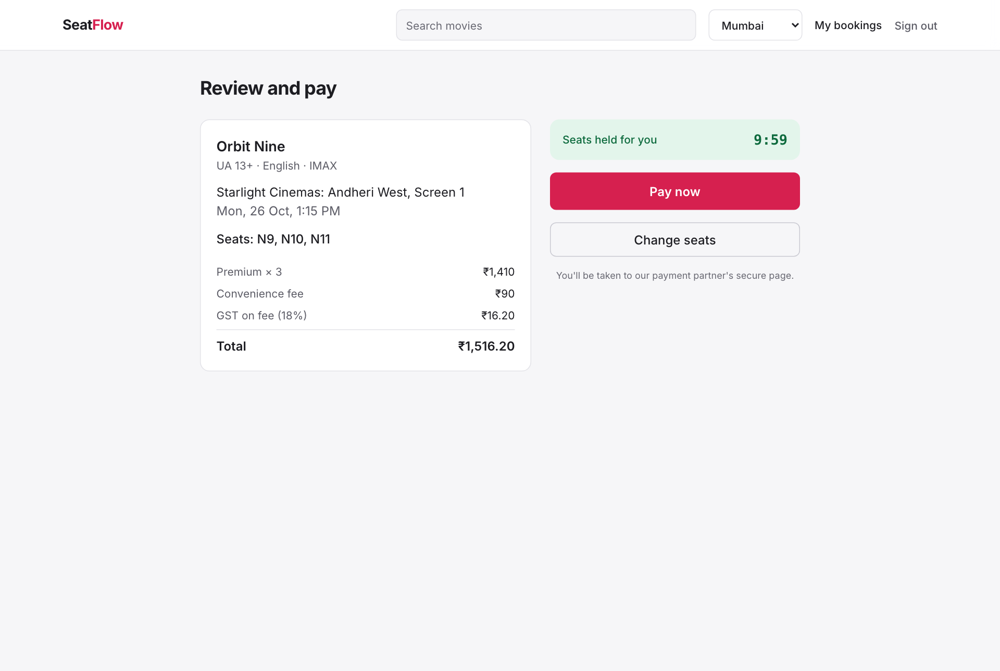
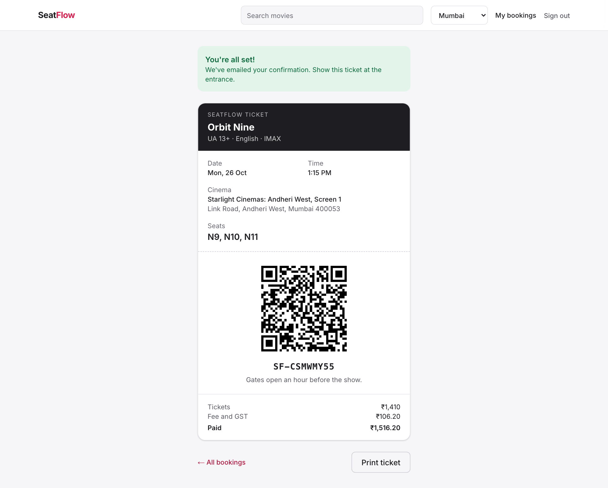
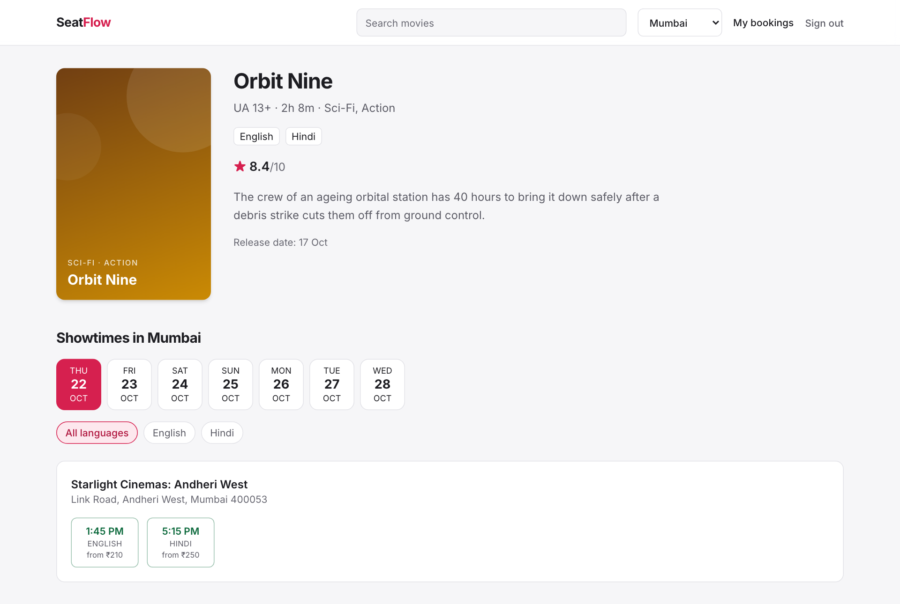
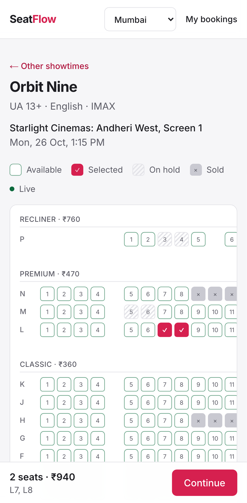
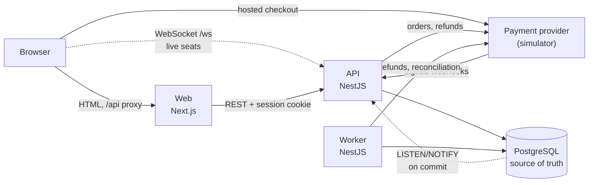

# SeatFlow

[](https://github.com/RutvikMendpara/seatFlow/actions/workflows/ci.yml)

A movie ticket booking platform: browse movies, pick a showtime, choose seats
on a live seat map, pay, and get a QR ticket.

The focus is on the part that's easy to get wrong: **no seat is ever sold
twice**, even when a thousand people go for the same seats at once, payments
arrive late or twice, or the database drops connections mid-booking.



## Highlights

- **Correct under contention.** 1,000 concurrent clients competing for 50
  seats, checked against the database after every run: no seat with two
  owners, every multi-seat hold all or nothing. Runs in CI.
  ([reservation lifecycle](docs/reservation-lifecycle.md))
- **Payments that can't lose money or double-sell.** Signed webhooks with
  dedupe, one transaction from event to ticket, reconciliation for lost
  webhooks, and automatic refunds through a transactional outbox when a late
  payment finds its seats gone. Every failure scenario in the spec has a test.
  ([payment consistency](docs/payment-consistency.md))
- **Live seat map.** Seat changes are pushed over WebSockets from a Postgres
  trigger that fires only on commit. Clients merge by per-seat version, so
  late or reordered messages can't show stale state.
  ([ADR 6](docs/adr/0006-live-seats-websocket-notify.md))
- **Measured optimization.** A lock-free fast path for plainly taken seats:
  **+66% throughput and −44% p95 latency** on the hottest seats, with k6
  against a production build. ([performance](docs/performance.md))
- **Survives failures.** Fault tests kill database connections in the middle
  of a booking storm. Data stays consistent and the API recovers by itself.
  These tests found and fixed a crash where a database restart would have
  taken the API down. ([testing](docs/testing.md#fault-injection))
- **Accessible.** The seat map works fully from the keyboard and with screen
  readers, and doesn't rely on colour. axe checks WCAG 2.2 AA in the browser
  tests. ([frontend](docs/frontend.md#accessibility))

| | |
|---|---|
|  |  |
|  |  |

## Architecture



- **Web** renders pages on the server and proxies `/api` to the API, so the
  session cookie is first-party.
- **API** owns all booking logic. Seat holds are row-locked transactions in
  Postgres, and the client never sends prices.
- **Worker** expires stale holds, reconciles open payments with the provider,
  and processes the outbox (refunds, confirmation emails).
- **Payment simulator** behaves like a real provider: hosted checkout, HMAC
  webhooks that can be delivered late, three times, or not at all.

It's a modular monolith ([ADR 3](docs/adr/0003-modular-monolith.md)): a
booking is one Postgres transaction, which microservices would turn into a
distributed problem.

## Stack

| | |
|---|---|
| Web | Next.js 16, React 19, Tailwind CSS 4 |
| API and worker | NestJS 12, Prisma 7 (plus raw SQL for locking), TypeScript |
| Data | PostgreSQL 18. Redis runs in Compose but isn't used yet. |
| Tests | Jest and Supertest against real Postgres, Vitest, Playwright with axe, k6 |
| Infra | Docker Compose, GitHub Actions |

## Running locally

You need Docker. pnpm is only needed to run tests or apps outside Docker.

```bash
cp .env.example .env
docker compose up --build --watch
```

In another terminal, load the sample data (fictional movies and cinemas
across five cities):

```bash
docker compose exec api pnpm db:seed
```

| Service | URL |
|---|---|
| Web | http://localhost:3000 |
| API | http://localhost:4000/api |
| Payment simulator | http://localhost:4100 |
| Postgres | localhost:5433 |

Payments go through the simulator, so no real money is involved. Its
checkout page lets you pay, decline, or choose how the webhook is delivered.
To book a ticket from the command line instead:

```bash
set -a; . ./.env; set +a
./scripts/demo-booking.sh
```

## Tests

```bash
cd apps/api && pnpm install
pnpm test              # unit
pnpm test:e2e          # API against Postgres: concurrency, payments, faults, security
pnpm test:concurrency  # just the 1000-clients-for-50-seats test

cd ../web
pnpm test                               # unit
pnpm exec playwright install chromium   # once
pnpm test:e2e                           # browser tests against the running stack
```

| Suite | Tests |
|---|---|
| API unit | 25 |
| API e2e (real Postgres) | 95 |
| Web unit | 7 |
| Playwright, desktop and Pixel 7 | 11 |

What each suite covers is in [docs/testing.md](docs/testing.md).

## Docs

- [Reservation lifecycle](docs/reservation-lifecycle.md): holds, lock ordering, expiry
- [Payment consistency](docs/payment-consistency.md): every payment failure case and how it's handled
- [Database design](docs/database-design.md): constraints and why each index exists
- [Frontend](docs/frontend.md): booking flow, live seats, accessibility
- [Testing](docs/testing.md) and [Performance](docs/performance.md)
- [Security](docs/security.md)
- Decisions:
  [Postgres as source of truth](docs/adr/0001-postgres-as-source-of-truth.md),
  [row locks](docs/adr/0002-row-locks-over-optimistic-concurrency.md),
  [modular monolith](docs/adr/0003-modular-monolith.md),
  [expiry during payment](docs/adr/0004-expiry-during-payment.md),
  [transactional outbox](docs/adr/0005-transactional-outbox.md),
  [live seat updates](docs/adr/0006-live-seats-websocket-notify.md)

## Limitations

Things deliberately left out or not done yet:

- **No admin UI.** Staff can check tickets in through the API, but there are
  no screens for managing movies, showtimes or prices. The seed data stands
  in.
- **Not deployed.** Docker images are development builds. Playwright runs
  locally, not in CI, because it needs the whole stack.
- **Single-instance assumptions.** Rate-limit counters are in memory. The
  booking logic itself is safe across instances, since it relies only on
  Postgres.
- **No real email, posters or trailers.** Emails are logged, and posters are
  generated from the title.
- **Performance numbers come from a laptop.** They show relative change, not
  production capacity ([performance](docs/performance.md#limitations)).
